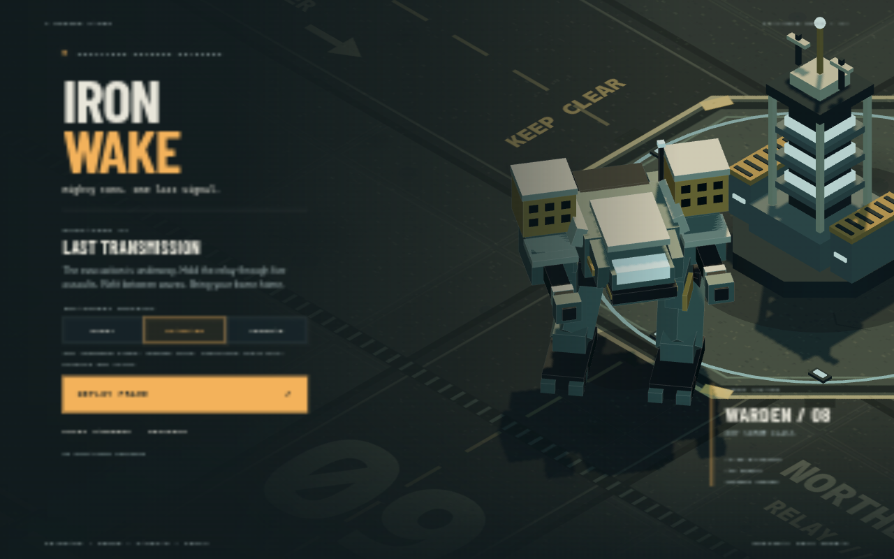
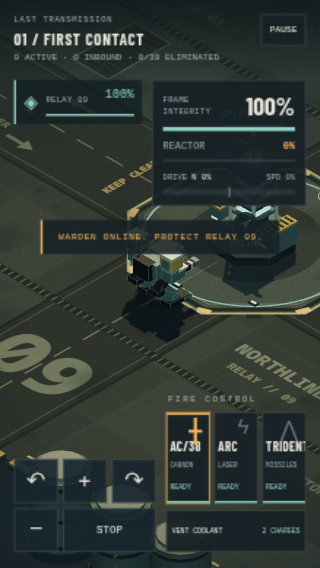

# Iron Wake · Last Transmission

A browser-only isometric mech-combat demo. Pilot Warden 08, an 80-ton siege
frame, through a complete relay-defense operation. Heavy persistent throttle
and independent turret tracking remain the core of the original prototype.

## The operation

Defend Relay 09 against 39 hostiles across five assaults: **First contact**,
**Crossfire**, **Hammerfall**, **Breaking point**, and **Iron crown**. The final
assault includes a command frame with heavier armor and faster artillery below
half health. Scouts close rapidly; strikers establish firing lines; siege
frames shell the relay from outside the central yard.

Orange ground circles mark committed artillery strikes. The impact point does
not chase the player, giving a frame starting from neutral time to accelerate
out. Radar, edge arrows, target brackets, range labels, health bars, impact
flashes, recoil, and differentiated silhouettes communicate the fight.

After each of the first four assaults, the simulation stops for field service.
Choose one stacking upgrade to continue:

- **Overpressure kit:** +15% cannon, laser, and missile damage.
- **Cryogenic loop:** +18% heat dissipation and an extra coolant charge.
- **Bastion plating:** −10% incoming frame damage and 12 relay integrity.

Every refit restores 25 frame integrity, purges heat, adds one coolant charge,
and returns the drive to neutral. Incoming hostile rounds and artillery finish
resolving before the yard is declared secure. A destroyed frame or relay loses
the operation, including during the final clearance period.

Story, Standard, and Veteran change hostile armor/damage and score multipliers.
The report records rank, score, kills, field time, relay integrity, projectile
hit rate, and installed refits. The latest eight reports and permanent best
result per difficulty are saved locally under `iron-wake:profile:v1`. A run in
progress is not saved across reloads. Invalid or unavailable storage does not
prevent play.

## Controls

| Action | Keyboard / mouse | Standard gamepad | Touch |
| --- | --- | --- | --- |
| Raise/lower persistent throttle | W/S or up/down | Left stick up/down | Hold +/− |
| Neutral; momentum decays | X | X / square | STOP |
| Turn hull | A/D or left/right | Left stick left/right | Turn arrows |
| Aim independent turret | Mouse | Right stick, in screen direction | Tap battlefield |
| Fire cannon | Space | RT | Hold AC/38 |
| Fire laser | Hold E | LT | Hold ARC |
| Homing missile salvo | Q | RB | Hold TRIDENT |
| Coolant purge | V | LB | Vent coolant |
| Select mouse weapon | Wheel or 1–3 | Dedicated weapon triggers | Weapon button |
| Fire selected mouse weapon | Hold left click | — | Weapon button |
| Pause / resume | Escape | Menu | Pause |
| Menus | Tab / Shift+Tab / Enter | D-pad or stick, A/cross confirm, B/circle back | Tap |

Controller left/right adjusts volume when a slider is focused; up/down moves
between settings. Touch controls are automatic for touch-first devices and can
also be enabled in Settings. Commanded throttle and actual signed speed remain
visible. Releasing the throttle control keeps the engine setting. Ordinary
pause preserves throttle and clears held inputs; deployment/refits start in
neutral. Controller disconnection pauses combat. Focus loss, hidden pages, and
WebGL context loss pause and silence the game; recovery requires explicit resume.

## Weapons and supplies

Cannon shells deal 38 base damage every 0.65 seconds, using nearest swept hits
and a roughly 845-unit flight range. The laser deals 48 base damage per second
to the first target within 620 units. Trident launches three 27-damage homing
missiles every 4.5 seconds, locking the enemy nearest the aim point within 900
units. Losing a target leaves the missile travelling straight.

Weapons share reactor heat. At 100%, weapons lock until heat falls to 35%.
Cooling normally removes 12 heat per second. A coolant charge purges 55 heat;
holding the button spends only one charge, and a cold reactor consumes none.
Every second elimination drops alternating repair or coolant salvage. Drive
within 55 units to recover it; full supplies leave it available, and salvage
expires after 45 seconds.

The industrial yard is deliberately open: painted routes, maintenance pads,
and scenery are visual landmarks, not hidden cover. Tall industry sits outside
the navigation bounds. Mechs and projectiles use the deterministic 2D ground
simulation; Three.js and ECSpresso's renderer3D plugin provide the presentation.

## Presentation and audio

The game includes an authored industrial yard, procedural surface textures,
layered frame geometry, dynamic lighting/shadows, animated planted-foot gait,
artillery warnings, weapon trails, and pooled effects. The briefing stages the
same playable model in a closer camera; deployment restores normal projection.

An original locally synthesized 96-BPM score changes its layers with combat
intensity and uses quieter briefing/refit arrangements. Layered weapon,
mechanical, impact, coolant, artillery, and outcome effects have separate mix
controls. Audio starts only after a gesture and degrades gracefully if the
audio device is unavailable. Settings include master/music/effects levels and
reduced motion, in addition to the operating system's motion preference.

All gameplay geometry, surface graphics, and music are original to this demo.
The bundled [Barlow Condensed](https://github.com/google/fonts/tree/main/ofl/barlowcondensed)
typeface is by the Barlow Project Authors, distributed under the
[SIL Open Font License](./public/licenses/Barlow-OFL.txt). There are no licensed
Battletech characters, names, graphics, music, or samples.

## Development and verification

From the workspace root: `bun install --frozen-lockfile`, then `bun run dev`.
For production validation, `bun run build` followed by `bun run preview` and
open `games/iron-wake/`. No game-specific build routes or desktop setup are
required. Run `bun run check` for tests, strict TypeScript, lint, and build.

Meaningful regression coverage includes persistent throttle, swept hits,
heat/salvage, deterministic complete operations, artillery escape/failure,
refit freeze/one-time application, upgrade effects, difficulty, projection and
aiming, gait, model depth, pooled resource disposal, storage corruption and
record retention, and controller edge/disconnect behavior.

Browser verification and screenshots are recorded with the delivery PR.
Automated controls and audio signal checks do not establish physical gamepad
or touch feel, speaker/headphone quality, or owner acceptance of combat balance.
This remains a browser demo; no Steam integration or desktop distribution is
included.

