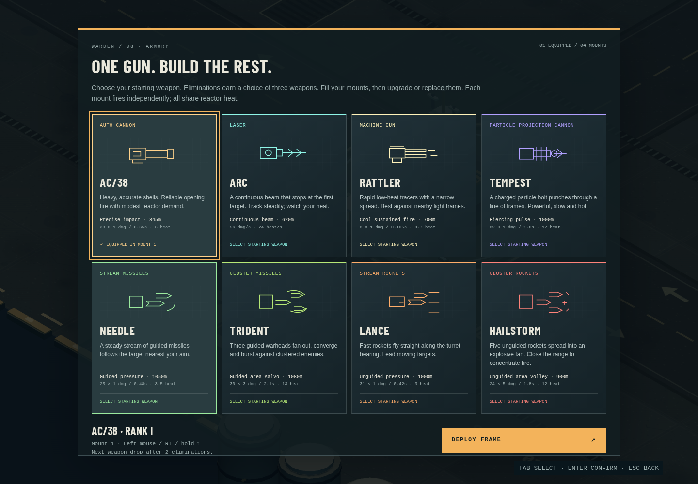
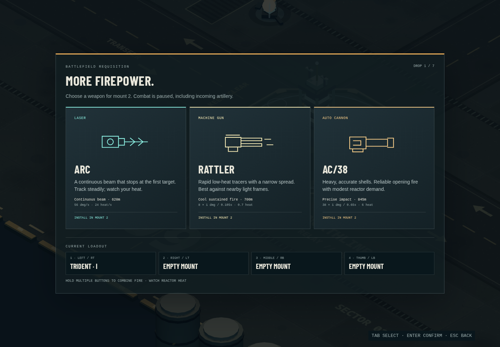
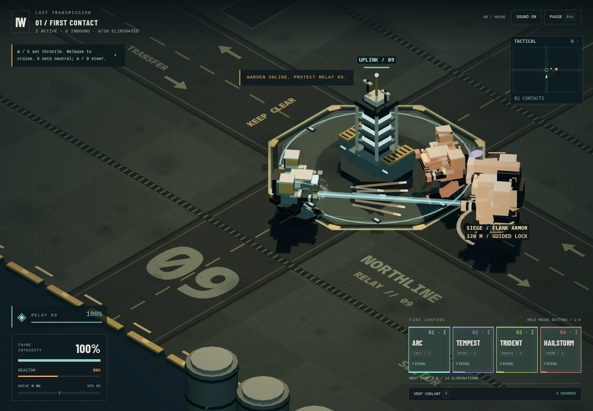

# Iron Wake · Last Transmission

A browser-only isometric mech-combat demo. Pilot Warden 08, an 80-ton siege
frame, through a complete relay-defense operation. Heavy persistent throttle
and independent turret tracking remain the core of the original prototype.

Choose a single starting weapon in the armory. Combat eliminations earn
three-choice weapon drafts at 2, 5, 9, 14, 20, 27, and 35 kills. The first three
drops fill the remaining mounts; later drops offer rank upgrades or new weapons
that explicitly replace a chosen mount. A weapon can reach rank III, with +30%
base damage per rank. Drafts pause the entire simulation, including artillery,
and preserve momentum. Each operation rolls new offers; no unlock grind is required.

**Frame Training** is a separate, unscored nine-drill range: cruise, neutral,
turning, cannon targeting, guided missiles, combined fire, heat, coolant, and artillery evasion.
It uses the operation’s actual controls and simulation, allows safe retries,
and starts a clean operation when you deploy. Pause can restart or exit training.

## The operation

Defend Relay 09 against 39 hostiles across five assaults: **First contact**,
**Crossfire**, **Hammerfall**, **Breaking point**, and **Iron crown**. The final
assault includes Iron Crown, a command frame whose barrage widens below half
health. Scouts close rapidly; strikers establish firing lines; siege
frames shell the relay from outside the central yard.

Siege frames turn slowly and carry frontal armor across a 120-degree arc.
Flank them to bypass it, or attack the green **EXPOSED** window after their
barrage for 135% damage. Their amber facing arc shows the protected side.
Ordinary siege frames commit two delayed impacts, then expose themselves for
3.2 seconds. Iron Crown commits repeated central impacts and two lateral
markers, expanding to four surrounding markers below half armor, then opens
a 4.2-second recovery window. Story uses lighter armor and single impacts.

Orange ground circles mark committed artillery strikes. The impact point does
not chase the player, giving a frame starting from neutral time to accelerate
out. Radar, edge arrows, target brackets, range labels, health bars, impact
flashes, recoil, and differentiated silhouettes communicate the fight.

After each of the first four assaults, the simulation stops for field service.
Choose one stacking upgrade to continue:

- **Overpressure kit:** +15% damage for every weapon family.
- **Cryogenic loop:** +18% heat dissipation and an extra coolant charge.
- **Bastion plating:** −10% incoming frame damage and 12 relay integrity.

Every refit restores 25 frame integrity, purges heat, adds one coolant charge,
and returns the drive to neutral. Incoming hostile rounds and artillery finish
resolving before the yard is declared secure. A destroyed frame or relay loses
the operation, including during the final clearance period.

Story, Standard, and Veteran change hostile armor/damage and score multipliers.
The report records rank, score, kills, field time, relay integrity, projectile
hit rate, and installed refits. The latest eight reports and permanent best
result per difficulty are saved locally under `iron-wake:profile:v1`. A run in
progress is not saved across reloads. Invalid or unavailable storage does not
prevent play.

## Controls

Press A / cross or Menu to claim a connected standard controller. The claiming
press is consumed; confirm again to deploy. Ownership stays with that controller
even when another is connected. Losing it pauses the game; a replacement must
be claimed and the operation explicitly resumed. Release sticks and triggers
after menu transitions to arm combat controls. Inputs held while returning
from a hidden window cannot resume the operation.

| Action | Keyboard / mouse | Standard gamepad | Touch |
| --- | --- | --- | --- |
| Raise/lower persistent throttle | W/S or up/down | Left stick up/down | Hold +/− |
| Neutral; momentum decays | X | X / square | STOP |
| Turn hull | A/D or left/right | Left stick left/right | Turn arrows |
| Aim independent turret | Mouse | Right stick, in screen direction | Tap battlefield |
| Fire mount 1 | Left mouse / hold 1 or Space | RT / R2 | Hold mount 1 |
| Fire mount 2 | Right mouse / hold 2 or E | LT / L2 | Hold mount 2 |
| Fire mount 3 | Middle mouse / hold 3 or Q | RB / R1 | Hold mount 3 |
| Fire mount 4 | Back/thumb mouse / hold 4 or F | LB / L1 | Hold mount 4 |
| Coolant purge | V | B / circle | Vent coolant |
| Pause / resume | Escape | Menu | Pause |
| Menus | Tab / Shift+Tab / Enter | D-pad or stick, A/cross confirm, B/circle back | Tap |

Hold any combination of firing controls to combine weapons. Each mount owns
its cooldown; all mounts track the same turret and share reactor heat. The
mouse thumb binding uses the browser's back-button input (button 3). Keyboard
bindings provide every firing slot on mice without extra buttons. Context menus
and middle-click actions are suppressed over the battlefield.

The active input device changes weapon and menu prompts. Controller use
automatically enables the larger interface; Settings can also enable it for
keyboard and mouse. Vibration for recoil and damage is optional and depends on
browser/controller support. Right-stick scrolling makes every long menu and
handbook section accessible without a pointer.

Controller left/right adjusts volume when a slider is focused; up/down moves
between settings. Touch controls are automatic for touch-first devices and can
also be enabled in Settings. Commanded throttle and actual signed speed remain
visible. Releasing the throttle control keeps the engine setting. Ordinary
pause preserves throttle and clears held inputs; deployment/refits start in
neutral. Controller disconnection pauses combat. Focus loss, hidden pages, and
WebGL context loss pause and silence the game; recovery requires explicit resume.

## Weapons and supplies

| Weapon | Family | Base behavior |
| --- | --- | --- |
| AC/38 | Auto cannon | 38-damage shell every 0.65s; precise impact |
| ARC | Laser | 56 damage/second; continuous first-target beam |
| Rattler | Machine gun | 8-damage tracer every 0.105s; low heat, narrow spread |
| Tempest | Particle projection cannon | 82-damage piercing bolt every 1.6s; high heat |
| Needle | Stream missiles | 25-damage guided missile every 0.48s |
| Trident | Cluster missiles | Three guided 30-damage warheads every 2.1s; area burst |
| Lance | Stream rockets | 31-damage unguided rocket every 0.42s |
| Hailstorm | Cluster rockets | Five unguided 24-damage rockets every 1.8s; area burst |

Missiles acquire the live target nearest the aim point within their range.
Losing a target leaves the missile flying straight. Rockets always retain their
launch heading. Cluster warheads deal 60% of direct damage to nearby frames;
PPC bolts hit each pierced frame once. Siege frontal armor and exposed windows
apply to every family. The target reticle reports guidance only when a fitted
missile weapon can actually acquire that target.
Weapons share reactor heat. At 100%, weapons lock until heat falls to 35%.
Cooling normally removes 12 heat per second. A coolant charge purges 55 heat;
holding the button spends only one charge, and a cold reactor consumes none.
Every second elimination drops alternating repair or coolant salvage. Drive
within 55 units to recover it; full supplies leave it available, and salvage
expires after 45 seconds.

The industrial yard is deliberately open: painted routes, maintenance pads,
and scenery are visual landmarks, not hidden cover. Tall industry sits outside
the navigation bounds. Mechs and projectiles use the deterministic 2D ground
simulation; Three.js and ECSpresso's renderer3D plugin provide the presentation.

## Presentation and audio

The game includes an authored industrial yard, procedural surface textures,
layered frame geometry, dynamic lighting/shadows, animated planted-foot gait,
artillery warnings, weapon trails, and pooled effects. The briefing stages the
same playable model in a closer camera; deployment restores normal projection.

Siege frames have broad armor and dorsal artillery for a distinct silhouette.
Committed barrages, exposed armor, player damage, and relay damage have separate
visual cues; critical world labels enlarge with the couch interface.

An original locally synthesized 96-BPM score changes its layers with combat
intensity and uses quieter briefing/refit arrangements. Layered weapon,
mechanical, impact, coolant, artillery, and outcome effects have separate mix
controls. Menu actions have short feedback cues, damage briefly lowers the
music, and footfalls follow the animated planted feet, including hull pivots.
Audio starts after browser activation and degrades gracefully if the device
is unavailable. If the browser requires a click or key press before accepting
controller-triggered audio, the interface reports that state explicitly. Settings
include master/music/effects levels and reduced motion, in addition to the
operating system's motion preference.

[Captured audio sample](./docs/demo-audio.wav): briefing music, combat, and menu
cues from the production browser. The excerpts are concatenated without mix
processing; this is a signal capture, not a listening-quality assessment.

All gameplay geometry, surface graphics, and music are original to this demo.
The bundled [Barlow Condensed](https://github.com/google/fonts/tree/main/ofl/barlowcondensed)
typeface is by the Barlow Project Authors, distributed under the
[SIL Open Font License](./public/licenses/Barlow-OFL.txt). There are no licensed
Battletech characters, names, graphics, music, or samples.

## Development and verification

From the workspace root: `bun install --frozen-lockfile`, then `bun run dev`.
For production validation, `bun run build` followed by `bun run preview` and
open `games/iron-wake/`. No game-specific build routes or desktop setup are
required. Run `bun run check` for tests, strict TypeScript, lint, and build.

Meaningful regression coverage includes persistent throttle, swept hits,
heat/salvage, four concurrent mounts, guided/unguided trajectories, piercing and area hits, draft freezing/queued rewards/replacement, deterministic complete operations, artillery escape/failure,
refit freeze/one-time application, upgrade effects, difficulty, projection and
aiming, gait, model depth, pooled resource disposal, storage corruption and
record retention, controller ownership/reconnect, held-input recovery, and
vibration cleanup. Training coverage includes completion, safe retry, delayed
coolant use, and entering the evasion drill from an arena boundary.

Moving heat-managed simulation policies can complete Standard and Veteran,
preserving substantially more frame and relay integrity than stationary play.
All eight starters can earn the first draft. These are balance guardrails, not
a measurement of first-time-player difficulty.

Browser verification and screenshots are recorded with the delivery PR.
Automated controls and audio signal checks do not establish physical gamepad
or touch feel, speaker/headphone quality, or owner acceptance of combat balance.
This remains a browser demo; no Steam integration or desktop distribution is
included.

