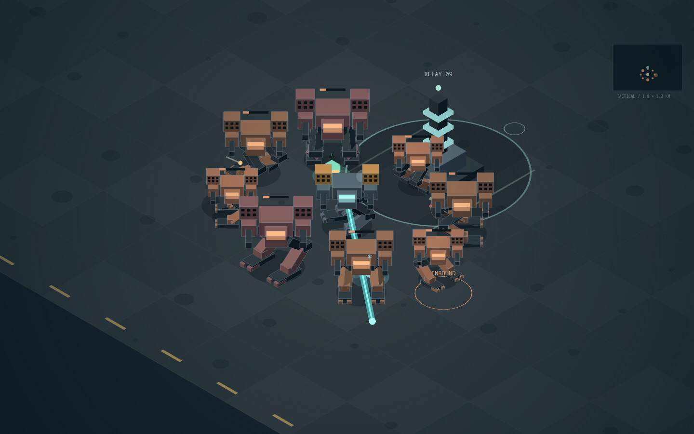

# Iron Wake · Alpha 01

An isometric mech defense game about heavy movement, combined firepower, and heat
management. Defend Relay 09 through three waves in an 80-ton siege frame.

The approved top-down prototype is preserved by Git tag `iron-wake-prototype`
(commit `dab35a7`). This alpha builds on its persistent throttle and independent
turret. There are no licensed assets, characters, or audio samples.

## Controls

| Action | Keyboard / mouse | Touch |
| --- | --- | --- |
| Raise/lower persistent throttle | W/S or up/down | Hold +/− |
| Neutral (slow with inertia) | X | Neutral |
| Turn hull | A/D or left/right | Turn arrows |
| Aim turret | Mouse | Tap battlefield |
| Select mouse weapon | Wheel down: next / up: previous (wraps) | — |
| Fire selected weapon | Hold left click | — |
| Cannon | Space | Hold Cannon |
| Laser | Hold E | Hold Laser |
| Homing missile salvo | Q | Missiles |
| Coolant purge | V | Coolant |
| Pause / controls | Esc / Pause | Pause |

Mouse selection starts on cannon each deployment and is outlined in cyan. Wheel
selection applies over the battlefield during play. Weapons can also be operated by holding their cockpit buttons on desktop.
Throttle stays set when released. The HUD distinguishes commanded throttle from
actual signed speed; reverse is slower. Pause and focus loss freeze movement
without discarding throttle. Deployments start in neutral.

## Combat rules

- Cannon: 38 damage, 0.65-second reload. Swept hits stop at the nearest target.
- Laser: 48 damage/second, first target along its 620-unit beam.
- Missiles: three homing rounds, 27 damage each, 4.5-second reload. Locks to the
  enemy closest to the aim point when fired; a lost target leaves a straight shot.
- Weapons share heat. At 100%, they lock until cooling to 35%.
- Coolant: two charges initially, maximum three. One press purges 55 heat; holding
  the button consumes only one charge. Vents at zero heat do not consume supplies.
- Scouts are fast and fragile; strikers hold medium range; siege frames have more
  armor and attack the relay from farther away. Inbound rings give two seconds
  of warning. Radar and screen-edge markers reveal distant live threats.
- Every second elimination drops alternating repair (+22 armor) or coolant (+1)
  salvage. Drive within 55 units to collect it. Full supplies leave it in place;
  salvage expires after 45 seconds.
- Wave clears repair 20 armor and return one coolant charge. Defeat all 21 enemies
  to win; lose if either the mech or the relay reaches zero armor.
- The industrial apron and terrain marks are decorative, with no hidden cover or
  collision. The ground boundary contains the mech. Turret tracking is limited.

## Rendering and lifecycle

ECSpresso 0.24.1's `renderer3D` plugin draws the world with the workspace's
Three.js dependency. Player and enemy frames, relay, apron, salvage, wrecks,
projectiles and effects share a depth buffer. Solid faces occlude naturally;
missile ports are front-facing surface details. Mech parts use instanced
material batches and a combined edge buffer. The decorative apron uses unlit
vertex colors to avoid a full-screen physical lighting shader.

`src/presentation.ts` owns the scene and renderer. `src/projection-3d.ts` matches
the recorded isometric framing and raycasts the ground for aiming. Screen-space
labels, radar and target markers use that same camera; the HTML cockpit stays
in place. Simulation, combat, AI and planted-foot gait remain on the original
2D ground plane at a fixed 60 Hz. Touch aiming supports a second finger while a
control is held. Reduced motion suppresses shake, decorative bobbing and CSS
transitions. Pause and focus loss freeze the simulation and silence audio.

WebGL context loss pauses the mission; recovery leaves it paused for explicit
resume. Final page teardown cancels frames, aborts listeners, disposes the ECS
world, releases shared and model GPU assets, removes the overlay canvas and
closes audio. Cached pages retain the world for browser Back. WebGL-unavailable
startup displays an error. Everything specific to the game lives here; only
the workspace lifecycle helper is imported.

Synthesized Web Audio provides engine/footsteps, weapons, impacts, cooling,
pickups and alerts. Audio unlocks on deployment, supports mute and leaves the
game playable when audio is unavailable.

## Prototype review for issue 15

The initial walking/turning comparison was delivered before the remaining
world migration. Owner feedback was: “There seems to be some artifacting going
on at the head of the mech. Otherwise looks good”. The visor and cockpit shell
had coincident front faces; a small physical separation fixes the artifact
without changing the silhouette or using camera-angle ordering rules.

The completed migration removes the superseded Canvas world renderer and
comparison route. The comparison image and first-stage commit in PR #26 retain
review evidence. The normal `games/iron-wake/` page now runs the 3D world.

## Validation

From the workspace root: `bun run dev`, or `bun run build` then `bun run preview`.
Open `games/iron-wake/`. Run `bun run check` for the whole workspace, or
`bun test games/iron-wake/tests` for this game.

Deterministic coverage includes combat and a winning full mission, projection
agreement with recorded Canvas framing, ground picking after camera shake and
resize, missile-port visibility, visor depth separation, world-space foot
planting, instanced poses across the renderer's transform phase, overlay
bounds, transient resets, reduced motion and GPU asset ownership.

Production Chromium checks keyboard/mouse weapons, persistent throttle,
coolant, sound/silence, pause/focus loss, simulated multitouch, portrait and
landscape layouts, context loss/recovery, cached/final page teardown and
fractional-DPR drawing-buffer stability. A separate presentation fixture
renders eight mechs, all combat-object types and a simulated mission ending
with 21 kills and 93% relay integrity. Independent reviews have no unresolved
findings. Physical touch hardware, GPU performance, speaker quality and owner
acceptance of the completed world remain separate from these browser checks.

The following are sequential, 120-frame samples at DPR 1 in headless Chromium
using software rendering. The baseline was captured before migration. The
desktop software path remains slower than Canvas; these are not hardware-GPU
or physical-phone performance claims.

| Viewport | Canvas median / p95 frame time | 3D median / p95 frame time |
| --- | --- | --- |
| 1440 × 900 | 16.7 / 16.8 ms | 33.3 / 33.4 ms |
| 390 × 844 | 16.7 / 16.7 ms | 16.7 / 16.8 ms |

The synthetic eight-mech desktop scene records 33.4 / 50.0 ms with 112 draw
calls. Batching reduced it from 634 calls before optimization. Repeated scene
resets return GPU geometry counts to the same plateau; final teardown releases
the WebGL context and removes the labels canvas. `bun run check` passes.
