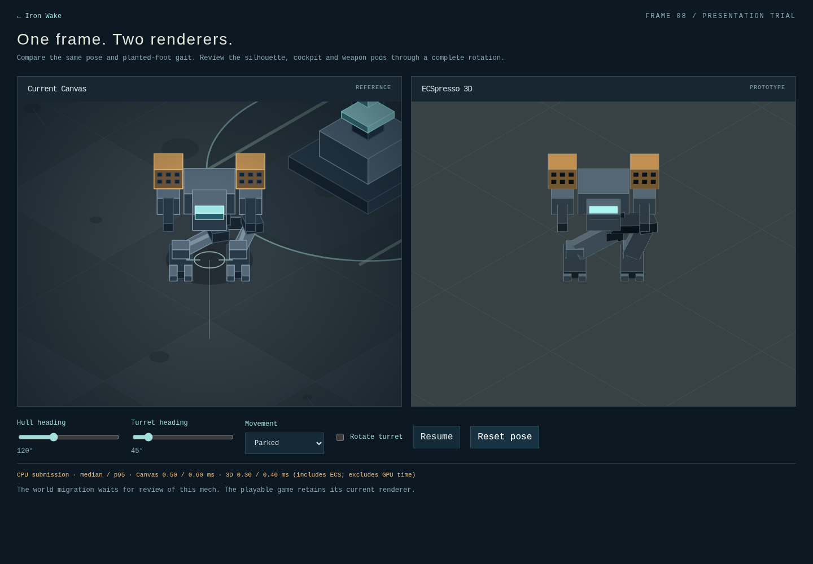

# Iron Wake · Alpha 01

An isometric mech defense game about heavy movement, combined firepower, and heat
management. Defend Relay 09 through three waves in an 80-ton siege frame.

The approved top-down prototype is preserved by Git tag `iron-wake-prototype`
(commit `dab35a7`). This alpha builds on its persistent throttle and independent
turret. There are no licensed assets, characters, or audio samples.

## Controls

| Action | Keyboard / mouse | Touch |
| --- | --- | --- |
| Raise/lower persistent throttle | W/S or up/down | Hold +/− |
| Neutral (slow with inertia) | X | Neutral |
| Turn hull | A/D or left/right | Turn arrows |
| Aim turret | Mouse | Tap battlefield |
| Select mouse weapon | Wheel down: next / up: previous (wraps) | — |
| Fire selected weapon | Hold left click | — |
| Cannon | Space | Hold Cannon |
| Laser | Hold E | Hold Laser |
| Homing missile salvo | Q | Missiles |
| Coolant purge | V | Coolant |
| Pause / controls | Esc / Pause | Pause |

Mouse selection starts on cannon each deployment and is outlined in cyan. Wheel
selection applies over the battlefield during play. Weapons can also be operated by holding their cockpit buttons on desktop.
Throttle stays set when released. The HUD distinguishes commanded throttle from
actual signed speed; reverse is slower. Pause and focus loss freeze movement
without discarding throttle. Deployments start in neutral.

## Combat rules

- Cannon: 38 damage, 0.65-second reload. Swept hits stop at the nearest target.
- Laser: 48 damage/second, first target along its 620-unit beam.
- Missiles: three homing rounds, 27 damage each, 4.5-second reload. Locks to the
  enemy closest to the aim point when fired; a lost target leaves a straight shot.
- Weapons share heat. At 100%, they lock until cooling to 35%.
- Coolant: two charges initially, maximum three. One press purges 55 heat; holding
  the button consumes only one charge. Vents at zero heat do not consume supplies.
- Scouts are fast and fragile; strikers hold medium range; siege frames have more
  armor and attack the relay from farther away. Inbound rings give two seconds
  of warning. Radar and screen-edge markers reveal distant live threats.
- Every second elimination drops alternating repair (+22 armor) or coolant (+1)
  salvage. Drive within 55 units to collect it. Full supplies leave it in place;
  salvage expires after 45 seconds.
- Wave clears repair 20 armor and return one coolant charge. Defeat all 21 enemies
  to win; lose if either the mech or the relay reaches zero armor.
- The industrial apron and terrain marks are decorative, with no hidden cover or
  collision. The ground boundary contains the mech. Turret tracking is limited.

## 3D presentation preview (issue 15)

Open `games/iron-wake/?mech-preview` in the development server or production
preview. The normal game still uses Canvas. This is the first, review-gated
stage of [issue 15](https://github.com/DeeGeeGames/playground/issues/15); the
remaining world migration must wait for feedback on appearance and movement.

The synchronized views share the existing simulation and planted-foot gait.
Set hull/turret headings independently, rotate the turret continuously, and
select forward walking, reverse or turning in place. Pause freezes simulation;
heading sliders also work while paused. Reset restores a parked frame. Reduced
motion starts parked and paused; motion remains available through Resume.
Focus loss pauses, and WebGL context recovery requires an explicit resume.

The 3D adapter uses ECSpresso 0.24.1's published `renderer3D` plugin with the
workspace's existing Three.js 0.186.1 dependency. Solid geometry uses normal
depth testing and front-face culling, including missile-port surface details.
The orthographic camera matches the Canvas projection. The model, renderer,
plugin world, GPU assets and event/frame handles are owned by this page and
disposed on teardown. Combat, AI, controls and the playable world are unchanged.

Production headless Chromium validation on 2026-10-29 covered eight turret
headings, independent hull/turret poses, walking/reverse/turn, pause and focus
loss, resize, reduced motion, simulated touch, context recovery, teardown and
WebGL startup failure. The normal game also passed throttle, weapon selection,
firing and pause checks. Independent code review has no unresolved findings.

| Viewport | Original game median / p95 frame time | Both comparison views median / p95 |
| --- | --- | --- |
| 1440 × 900 | 16.7 / 16.8 ms | 16.7 / 33.3 ms |
| 390 × 844 | 16.7 / 16.7 ms | 16.7 / 33.4 ms |

These are 120-frame samples in software-rendered Chromium. The comparison runs
both renderers; it does not establish the performance of a migrated game or a
physical mobile device. The preview's CPU submission readout excludes GPU time.
Physical-device performance and owner appearance/movement acceptance remain
unmeasured. Regression tests cover camera alignment, port visibility through a
full rotation and world-space foot planting. `bun run check` passes.

## Gameplay implementation and validation

Canvas 2D draws raised, depth-sorted isometric geometry; simulation remains in
world coordinates with a fixed 60 Hz timestep. Projection and inverse picking
live in `src/projection.ts`. Touch aiming also supports a second finger while a
control is held. Reduced motion suppresses screen shake and CSS transitions.

Synthesized Web Audio provides engine/footsteps, weapons, impacts, cooling,
pickups, and alerts. Audio unlocks on deployment, supports mute, stops on pause,
and fails gracefully when unavailable. No external assets, new dependencies,
network services, persistence, or ECS changes in the playable game. Everything
specific to this game lives here; only the workspace lifecycle helper is imported.

From the workspace root: `bun run dev`, or `bun run build` then `bun run preview`.
Open `games/iron-wake/`. Run `bun run check` for the whole workspace, or
`bun test games/iron-wake/tests` for combat/projection checks.

Deterministic tests cover throttle, combat, roles, salvage, coolant, spawn
warnings, terminal behavior, isometric projection, and a viable full-mission
strategy. Local Playwright/Chromium checks production desktop and simulated
touch layouts, sound output/silence, input and terminal/restart flows. Physical
touch hardware, speaker quality, and owner gameplay acceptance remain separate.
